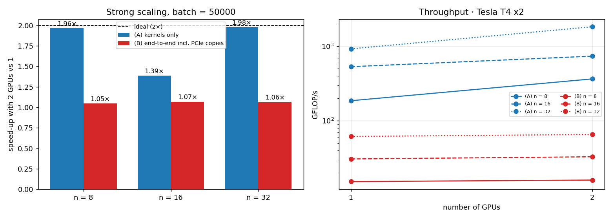

# CUDA: From Zero to Hero 🚀
**AKT26 Hackathon · Homework 4 · Team 1036 — THE COUNCIL** (Al Akhawayn University in Ifrane, Morocco)

Hi! This is our fork of [abdelfattah83/akt26_gpu_dev](https://github.com/abdelfattah83/akt26_gpu_dev).
We wrote two GPU kernels from scratch, checked them against NVIDIA's own library (cuBLAS), and then kept going to see how far we could push them.

## TL;DR
| | What we did | Result |
|---|---|---|
| ✅ **Assignment 1** · `3-ger/` | Update a big matrix with a rank-1 product | Correct on every size, **as fast as cuBLAS** (1.12× faster on the default size) |
| ✅ **Assignment 2** · `4-gemm/` | Multiply thousands of small matrices at once | Correct on every size, **2.2× faster than cuBLAS** at 16 × 16, **4.2×** at 7 × 7 |
| 🔍 **Safety check** | Ran NVIDIA's `compute-sanitizer` | 0 memory errors, 0 race conditions, 0 leaks |
| ⭐ **Extra A** | Two optimized versions of the matrix kernel | **Faster than cuBLAS for every size from 1 to 32** (up to 976 GFLOP/s) |
| ⭐ **Extra B** | Tried 11 different thread-block shapes | Shows why memory access patterns matter (4× difference) |
| ⭐ **Extra C** | Split the work across **two GPUs** | Computation: **1.98× faster**. With data transfers: only 1.06×, and we explain why |

> The graded code lives in **`3-ger/`** and **`4-gemm/`**. We did not rename folders, move `main`, or edit the makefiles.
> Everything extra is in **`5-extras/`**, so it can't break the graded part.

**Where we ran it:** NVIDIA Tesla T4 on Google Colab (CUDA 13.0), and 2 × Tesla T4 on Kaggle (CUDA 12.8) for the multi-GPU test.

---

## ▶️ Try it yourself
```bash
cd 3-ger  && make && ./ger                # default: 4000 x 2000 matrix
cd 4-gemm && make && ./gemm               # default: 1000 matrices of 16 x 16
```
You can also pass your own sizes: `./ger 1000 777` or `./gemm 7 5000`.

💡 The makefiles target newer GPUs (`sm=80`). On a T4 (Colab/Kaggle), add `sm=75`: `make sm=75`. No need to edit anything.

Want to re-run *everything* (tests, sanitizer, studies, plots) in one go?
```bash
bash 5-extras/run_all.sh 75
```

---

## 1️⃣ Assignment 1 — Rank-1 update (`3-ger`)
**The task:** update every element of a matrix: `A(i,j) = A(i,j) + α · x[i] · y[j]`.

**Our idea, in plain words:**
* Every element can be updated on its own, so we give **one GPU thread to each element**. That's 8 million threads for the default 4000 × 2000 matrix.
* The matrix is stored **column by column**. We make neighbouring threads work on neighbouring rows of the same column, so they read memory side by side. The GPU loves that: it's called a *coalesced* access.
* Threads are grouped in blocks of **32 × 8 = 256**. We launch just enough blocks to cover the whole matrix, and a simple `if (i < m && j < n)` stops the extra threads at the edges.

**How did it go?**

| Matrix size | Our kernel | cuBLAS | Who wins? |
|---|---|---|---|
| 4000 × 2000 (default) | 267.8 µs · 59.7 GFLOP/s | 299.3 µs | **us, 1.12×** |
| 1000 × 777 | 15.3 µs | 12.7 µs | cuBLAS (we're at 0.83×) |
| 4001 × 3 (awkward shape) | 2.5 µs | 3.0 µs | **us, 1.20×** |
| 33 × 65 | 2.5 µs | 3.4 µs | **us, 1.32×** |
| 1 × 1 (tiny) | 2.9 µs | 2.8 µs | tie |

Every run prints **TEST PASS**. The error is about 4 × 10⁻⁸, the same as cuBLAS and far below the 10⁻⁶ limit.

**Why can't anyone go much faster?** For each number we do very little math (2 operations) but we must read it and write it back (8 bytes). So the speed is limited by **memory, not computation**. Our kernel moves about 240 GB/s, roughly **75% of what the T4's memory can do** (≈ 320 GB/s). That ceiling is the same for cuBLAS, which is why we end up neck and neck.

---

## 2️⃣ Assignment 2 — Many small matrix multiplications (`4-gemm`)
**The task:** compute `C = A × B` for a whole *batch* of small matrices (up to 32 × 32), all at once.

**Our idea, in plain words:**
* **One block of threads per matrix**, and **one thread per element of the result**. A 16 × 16 matrix gets 256 threads; a 32 × 32 one gets 1024, the maximum allowed.
* Each element of C needs a whole row of A and a whole column of B. Instead of fetching them again and again from the slow main memory, the block first copies A and B into **shared memory**, a small, very fast scratchpad that all threads of the block can see.
* Everyone waits at `__syncthreads()` until the copy is complete, then each thread computes its own number.
* We also wrote all the "plumbing": GPU memory allocation, copies, timing with CUDA events (1 warm-up + 100 timed runs), the cuBLAS comparison (`cublasSgemmStridedBatched`), and cleanup.

**How did it go?**

| Matrix size × how many | Our kernel | cuBLAS | Who wins? |
|---|---|---|---|
| 16 × 16 × 1000 (default) | 16.4 µs · **500 GFLOP/s** | 35.3 µs · 232 GFLOP/s | **us, 2.16×** |
| 7 × 7 × 5000 | 21.0 µs · 163 GFLOP/s | 88.3 µs · 39 GFLOP/s | **us, 4.20×** |
| 17 × 17 × 1 | 2.5 µs | 7.3 µs | **us, 2.88×** |
| 1 × 1 × 1000 | 4.1 µs | 7.0 µs | **us, 1.70×** |
| 32 × 32 × 1000 | 102.5 µs · 639 GFLOP/s | 99.1 µs · 661 GFLOP/s | tie (0.97×) |
| 31 × 31 × 20000 | 2393.9 µs | 2235.7 µs | cuBLAS (we're at 0.93×) |

Every run prints **TEST PASS** (error ≤ 4 × 10⁻⁸).

**Why do we beat cuBLAS on small matrices?** cuBLAS is built for big matrices: it cuts them into fixed-size tiles. A 7 × 7 matrix leaves most of each tile empty, so a lot of work is wasted. Our kernel is tailored to exactly one small matrix per block, with no waste. Around 32 × 32 cuBLAS catches up, because its tricks start to pay off. We beat that too in Extra A below.

---

## 🔍 Is it really correct? (`compute-sanitizer`)
Passing the tests is good; proving there are no hidden bugs is better. We used NVIDIA's checking tool, shown in the lecture:

| What it looks for | Program | Result |
|---|---|---|
| Reading/writing outside the arrays + memory leaks | `ger`, `gemm` | **0 errors, 0 bytes leaked** |
| Threads stepping on each other in shared memory (race conditions) | `gemm`, all Extra kernels | **0 hazards** |
| Wrong use of `__syncthreads()` | `gemm` | **0 errors** |

Full logs: [`sanitizer.txt`](5-extras/results_Tesla_T4/sanitizer.txt) · all graded runs: [`graded_runs.txt`](5-extras/results_Tesla_T4/graded_runs.txt)

---

## ⭐ Extras — going a bit further (`5-extras/`)

### A. Can we beat cuBLAS at *every* size? Yes!
In [`gemm_opt.cu`](5-extras/gemm_opt.cu) we tried two improvements on our Assignment 2 kernel and tested every matrix size from 1 to 32:

* **v1 — "pack several small matrices per block".** GPU threads work in groups of 32 (a *warp*). A 7 × 7 matrix only needs 49 threads, so part of the second warp sits idle. We put several small matrices in the same block so the warps are full.
* **v2 — "each thread does 4 results instead of 1".** A thread computes a little 2 × 2 square of C. It loads 2 numbers of A and 2 of B and uses them for 4 multiplications. That's half as many memory reads per operation, the same trick cuBLAS uses for big matrices.

| Matrix size | Best version | Our speed | cuBLAS | How much faster |
|---|---|---|---|---|
| 1 to 11 | v1 (packed) | up to 421 GFLOP/s | up to 112 GFLOP/s | **2.5× – 5.4×** |
| 12 to 32 | v2 (4 results / thread) | up to **976 GFLOP/s** | up to 717 GFLOP/s | **1.2× – 5.2×** |
| exactly 32 | v2 | **975.6 GFLOP/s** | 717.1 GFLOP/s | **1.36×** |

Every version is checked against the CPU result for every size.


### B. Does the shape of a thread block matter? A lot.
In [`ger_sweep.cu`](5-extras/ger_sweep.cu) we ran our Assignment 1 kernel with 11 different block shapes.

* **Reading memory "side by side" is everything.** With blocks of 32+ threads along the rows, we get ≈ 240 GB/s. With the shape (1, 256), neighbouring threads jump far apart in memory, and speed drops to ≈ 57 GB/s, **4× slower**, even though the code is identical!
* **One warp per block is not enough.** (32, 1) blocks reach only ≈ 180 GB/s. With 4 or more warps per block, the GPU always has some work ready while others wait for memory.
* On a huge 8192 × 8192 matrix, our best shape hits **248 GB/s, vs 231 GB/s for cuBLAS**.


### C. What if we use two GPUs?
Kaggle offers a machine with **two T4 GPUs**, so we split the batch in half: GPU 0 takes the first 25,000 matrices, GPU 1 the other 25,000 ([`multi_gpu_gemm.cu`](5-extras/multi_gpu_gemm.cu)). We measured it two ways:

* **(A) Computation only**: the data is already on the GPUs.
* **(B) The whole job**: send the data to the GPUs, compute, bring the results back.

| Matrix size (50,000 of them) | (A) 1 GPU → 2 GPUs | (A) speed-up | (B) 1 GPU → 2 GPUs | (B) speed-up |
|---|---|---|---|---|
| 8 × 8 | 275 → 140 µs | **1.96×** | 3.36 → 3.20 ms | 1.05× |
| 16 × 16 | 769 → 555 µs | 1.39× | 13.3 → 12.5 ms | 1.07× |
| 32 × 32 | 3541 → 1790 µs (**1.83 TFLOP/s**) | **1.98×** | 53.2 → 50.0 ms | 1.06× |

All results checked against the CPU ✅

**So… why is the whole job barely faster?**
* The computation itself splits **almost perfectly** (1.96–1.98×).
* But the multiplication only takes **6–8% of the total time**. The other ~93% is moving data between the computer's memory and the GPUs.
* This is **Amdahl's law** from Session 3: if only 7% of the work gets faster, two GPUs can at best give 1 / (0.93 + 0.07/2) ≈ **1.04×**. That's exactly what we measured.
* And the data transfers don't get faster with a second GPU: the total speed stays at **≈ 12 GB/s** either way. `nvidia-smi topo -m` ([`topology.txt`](5-extras/results_Tesla_T4_x2/topology.txt)) shows both GPUs reach the CPU through the same PCIe host bridge (`PHB`, no NVLink), so they share that road.
* The 16 × 16 case (1.39×) is the odd one out; we haven't found the cause yet (it might be clock differences between the two GPUs).



---

## 💡 What we learned
1. **Think about memory first.** Both kernels are mostly limited by how fast data moves, not by how fast the GPU calculates. Reading memory "side by side" alone made a 4× difference.
2. **Fit the work to the hardware.** Full warps and enough threads per block keep the GPU busy; for tiny matrices, packing several per block made us up to 5× faster than cuBLAS.
3. **Re-use what you load.** Shared memory and computing several results per thread cut memory traffic, the same idea as in professional libraries.
4. **More GPUs ≠ automatically faster.** If moving the data costs more than computing, a second GPU barely helps. The data should stay on the GPU across many operations.
5. **Always check correctness.** Every number above comes with a CPU comparison, and the sanitizer found zero problems.

---

<sub>All raw numbers are in the repo: [`gemm_sweep.csv`](5-extras/results_Tesla_T4/gemm_sweep.csv) · [`ger_sweep.csv`](5-extras/results_Tesla_T4/ger_sweep.csv) · [`multi_gpu.csv`](5-extras/results_Tesla_T4_x2/multi_gpu.csv). Re-run the multi-GPU study with `bash 5-extras/run_multi_gpu.sh 75` on a machine with several GPUs.</sub>
