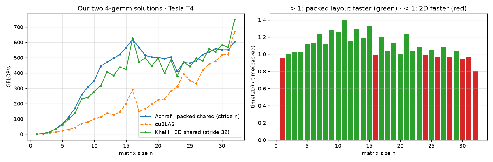

# CUDA: From Zero to Hero

AKT26 Hackathon, Homework 4. Team 1036, THE COUNCIL (Al Akhawayn University in Ifrane, Morocco)

This is our team's fork of [abdelfattah83/akt26_gpu_dev](https://github.com/abdelfattah83/akt26_gpu_dev).
We wrote the two GPU kernels asked in the homework, compared them with NVIDIA's own library (cuBLAS), and then spent some extra time trying to understand where the speed comes from.

## Summary

| Part | What it is | What we got |
|---|---|---|
| Assignment 1, `3-ger/` | Add a rank-1 product to a large matrix | Correct on every size we tried, same speed as cuBLAS (1.11x faster on the default size) |
| Assignment 2, `4-gemm/` | Multiply thousands of small matrices at the same time | Correct on every size, 2.1x faster than cuBLAS at 16 x 16 and 5.5x faster at 7 x 7 |
| Team comparison | We had two working versions of `4-gemm` and measured them against each other | One is better for small matrices, the other for the biggest ones. We explain why |
| Safety check | NVIDIA `compute-sanitizer` | No memory errors, no race conditions, no leaks |
| Extra A | Two faster versions of the `4-gemm` kernel | Faster than cuBLAS at every size from 1 to 32 (up to 976 GFLOP/s) |
| Extra B | 11 different thread block shapes for `3-ger` | The wrong shape is 4 times slower with the same code |
| Extra C | The same work split over two GPUs | The computation is 1.98x faster, but the whole job only 1.06x, because of data transfers |

The graded code is in `3-ger/` and `4-gemm/`. We did not rename any folder, move `main`, or edit the makefiles. Everything extra is in `5-extras/`, so it cannot break the graded part.

We ran everything on an NVIDIA Tesla T4 on Google Colab (CUDA 13.0), and on a Kaggle machine with two Tesla T4 GPUs (CUDA 12.8) for the multi-GPU test.

---

## How to run it

```bash
cd 3-ger  && make && ./ger                # default: 4000 x 2000 matrix
cd 4-gemm && make && ./gemm               # default: 1000 matrices of 16 x 16
```
You can also give your own sizes, for example `./ger 1000 777` or `./gemm 7 5000`.

The makefiles are set for newer GPUs (`sm=80`). On a T4 (Colab or Kaggle) just add `sm=75`, like `make sm=75`. Nothing needs to be edited.

To run all our tests and studies at once:
```bash
bash 5-extras/run_all.sh 75          # all the studies and plots
bash 5-extras/run_final_check.sh 75  # graded programs, edge cases, sanitizer and team comparison
```
If you don't have a GPU, open [`5-extras/colab_final_check.ipynb`](https://colab.research.google.com/github/KatAIml/akt26_gpu_dev/blob/main/5-extras/colab_final_check.ipynb) in Colab, choose a T4 runtime and click "Run all". It clones this repository and runs the full final check in about 3 minutes.

---

## Assignment 1: rank-1 update (`3-ger`)

The task is to update every element of a matrix: `A(i,j) = A(i,j) + alpha * x[i] * y[j]`.

How we did it:
- Each element can be updated without looking at any other, so we use one GPU thread per element. For the default 4000 x 2000 matrix that is 8 million threads.
- The matrix is stored column by column. We let neighbouring threads handle neighbouring rows of the same column, so a group of 32 threads (a warp) reads one continuous piece of memory. This is called coalesced access and it is the main thing that makes this kernel fast.
- Threads are grouped in blocks of 32 x 8 = 256. We launch just enough blocks to cover the matrix, and the test `if (i < m && j < n)` stops the extra threads at the borders.

Results on the T4:

| Matrix size | Our kernel | cuBLAS | Result |
|---|---|---|---|
| 4000 x 2000 (default) | 274.4 µs, 58.3 GFLOP/s | 305.1 µs | we are 1.11x faster |
| 1000 x 777 | 17.0 µs | 12.7 µs | cuBLAS is faster (we reach 0.75x) |
| 4001 x 3 | 2.7 µs | 3.0 µs | we are 1.11x faster |
| 33 x 65 | 2.9 µs | 3.4 µs | we are 1.18x faster |
| 1 x 1 | 3.1 µs | 3.2 µs | same |

Every run prints TEST PASS. The error is around 4e-8, the same as cuBLAS and well below the 1e-6 limit.

Why it can't go much faster: for each element we only do 2 operations, but we have to read and write 8 bytes. So the limit is memory speed, not calculation speed. Our kernel moves about 240 GB/s, around 75% of the T4's memory bandwidth (320 GB/s). cuBLAS hits the same limit, which is why the two are so close.

---

## Assignment 2: many small matrix multiplications (`4-gemm`)

The task is to compute `C = A * B` for a whole batch of small matrices (up to 32 x 32), all at once.

How we did it:
- One block of threads per matrix, and one thread per element of the result C. A 16 x 16 matrix gets 256 threads, a 32 x 32 matrix gets 1024, which is the maximum per block.
- Each element of C needs a full row of A and a full column of B. Reading them again and again from main memory would be slow, so each block first copies its A and B into shared memory. Shared memory is a small and very fast memory that all threads of a block can read.
- All threads wait at `__syncthreads()` until the copy is finished. Then each thread computes its own element.
- In shared memory we store each matrix "packed": its columns are `n` positions apart instead of 32. This small choice avoids bank conflicts for small matrices. The section "Our two versions of 4-gemm" below explains it.
- We also wrote all the host code around the kernel: memory allocation, copies, timing with CUDA events (1 warm-up and 100 timed runs), the cuBLAS comparison with `cublasSgemmStridedBatched`, and the cleanup.

Results on the T4:

| Matrix size and count | Our kernel | cuBLAS | Result |
|---|---|---|---|
| 16 x 16, 1000 matrices (default) | 15.1 µs, 543 GFLOP/s | 32.1 µs, 255 GFLOP/s | we are 2.13x faster |
| 7 x 7, 5000 matrices | 14.3 µs, 240 GFLOP/s | 78.7 µs, 44 GFLOP/s | we are 5.50x faster |
| 17 x 17, 1 matrix | 3.4 µs | 7.6 µs | we are 2.24x faster |
| 1 x 1, 1000 matrices | 3.7 µs | 7.1 µs | we are 1.91x faster |
| 32 x 32, 1000 matrices | 110.8 µs, 591 GFLOP/s | 90.0 µs, 729 GFLOP/s | cuBLAS is faster (we reach 0.81x) |
| 31 x 31, 20000 matrices | 2950 µs | 2479 µs | cuBLAS is faster (we reach 0.84x) |

Every run prints TEST PASS, with an error of at most 4e-8. The full output is in [`final_check/graded_runs.txt`](5-extras/results_Tesla_T4/final_check/graded_runs.txt).

Why we beat cuBLAS on small matrices: cuBLAS is designed for large matrices and cuts them into tiles of a fixed size. A 7 x 7 matrix fills only a small part of a tile, so most of the work is wasted. Our kernel is made for exactly one small matrix per block, so nothing is wasted. From about 30 x 30, the matrices are big enough for cuBLAS's methods to pay off and it catches up. In Extra A we show a version that beats it at those sizes as well.

---

## Checking correctness with compute-sanitizer

Passing the tests is one thing, but we also wanted to be sure there was no hidden bug. We used NVIDIA's `compute-sanitizer`, which was shown in the lecture:

| What it checks | Programs | Result |
|---|---|---|
| Reads or writes outside the arrays, and memory leaks | `ger`, `gemm` | 0 errors, 0 bytes leaked |
| Threads overwriting each other in shared memory (race conditions) | `gemm` and all the extra kernels | 0 hazards |
| Wrong use of `__syncthreads()` | `gemm` | 0 errors |

We ran it again on the final version of the code and got the same clean result.
Logs: [`final_check/sanitizer.txt`](5-extras/results_Tesla_T4/final_check/sanitizer.txt). All graded runs: [`final_check/graded_runs.txt`](5-extras/results_Tesla_T4/final_check/graded_runs.txt) (11 out of 11 TEST PASS, including unusual sizes such as 4001 x 3, 33 x 65, 20000 matrices of 31 x 31, and a batch of a single matrix).

---

## Our two versions of 4-gemm

Two of us (Khalil and Achraf) wrote the assignments separately before we put the work together. For `3-ger` we ended up with the same kernel and the same 32 x 8 blocks, which was a good sign. For `4-gemm` the overall idea was also the same (one block per matrix, one thread per result, A and B copied to shared memory), but one detail was different: how the matrix is stored in shared memory.

| | 2D version | Packed version |
|---|---|---|
| Shared memory array | `float sA[32][32]` | `float sA[32*32]` |
| Where element (row, col) goes | `sA[col][row]`, so columns are always 32 positions apart | `sA[col*n + row]`, so columns are only `n` positions apart |

Why this matters: shared memory is divided into 32 banks. When threads of the same warp read different addresses that sit in the same bank, the reads cannot happen together and the threads have to wait for each other. This is called a bank conflict.

Take an 11 x 11 matrix. One warp has 32 threads, so it covers 3 columns of C, which means it reads 3 different columns of B at the same moment:
- 2D version: the columns are 32 apart, at addresses `k`, `32 + k` and `64 + k`. All three are in the same bank, so the warp needs 3 reads.
- Packed version: the columns are 11 apart, at addresses `k`, `11 + k` and `22 + k`. They are in 3 different banks, so one read is enough.

We wrote [`team_compare.cu`](5-extras/team_compare.cu) to measure both versions and cuBLAS on every size from 1 to 32 (1000 matrices, 200 timed runs each, every result checked against the CPU).



What we found:
- **For small and medium matrices, the packed version is better.** It is faster at 24 of the 32 sizes, by up to 1.40x (at n = 11). This is where a warp covers several columns, so this is where the bank conflicts happen in the 2D version.
- **For the biggest matrices, the 2D version is better.** It is ahead at n = 28, 30, 31 and 32, and at n = 32 the gap is clear: 749 GFLOP/s against 604. The difference showed up most in our heaviest test, 20,000 matrices of 31 x 31. There the 2D version reached 0.93x of cuBLAS's speed and the packed version 0.84x. (These two numbers come from two separate Colab runs, so we compare them through cuBLAS, which was timed in the same run each time.)
- Why the 2D version wins at the top: at n = 32 both versions put the columns 32 apart, so the bank conflicts are exactly the same and that advantage is gone. What is left is the address calculation. In `sA[k][row]` the step of 32 is fixed when the code is compiled, so the compiler can turn it into constants. In `sA[k*n + row]` the GPU has to multiply by `n` while running. It's a small cost, but at these sizes it is the only difference between the two.

What we kept in the graded `4-gemm`: the packed version, because it is faster for most sizes, including the default 16 x 16 case and all the small sizes where this kind of batched kernel is most useful. It also checks the return value of every CUDA and cuBLAS call. While reviewing it we found one weak point: before the cuBLAS run, the output array `d_C` still contained our own kernel's result. If cuBLAS had silently written nothing, the test would still have passed. The 2D version already cleared `d_C` with `cudaMemset` before calling cuBLAS, so we added that line, and now each check is independent.

For the large sizes, Extra A below has a version that is faster than both of ours (976 GFLOP/s at n = 32, 1.36x faster than cuBLAS).

Both original versions are kept unchanged in [`5-extras/team_variants/`](5-extras/team_variants/), and the raw numbers are in [`team_compare.csv`](5-extras/results_Tesla_T4/final_check/team_compare.csv).

---

## Extra work (`5-extras/`)

### A. Beating cuBLAS at every size

In [`gemm_opt.cu`](5-extras/gemm_opt.cu) we tried two improvements of the Assignment 2 kernel and tested every matrix size from 1 to 32:

- v1, several matrices per block: threads run in warps of 32. A 7 x 7 matrix only needs 49 threads, so half of the second warp has nothing to do. Putting several small matrices in the same block fills the warps.
- v2, four results per thread: each thread computes a 2 x 2 square of C. It loads 2 values of A and 2 of B and uses them for 4 multiplications, so it needs half as many memory reads per operation. cuBLAS uses the same idea for large matrices.

| Matrix size | Best version | Our speed | cuBLAS | Speed-up |
|---|---|---|---|---|
| 1 to 11 | v1 | up to 421 GFLOP/s | up to 112 GFLOP/s | 2.5x to 5.4x |
| 12 to 32 | v2 | up to 976 GFLOP/s | up to 717 GFLOP/s | 1.2x to 5.2x |
| 32 | v2 | 975.6 GFLOP/s | 717.1 GFLOP/s | 1.36x |

Every version is checked against the CPU result for every size.


### B. Does the shape of the thread block matter?

In [`ger_sweep.cu`](5-extras/ger_sweep.cu) we ran the Assignment 1 kernel with 11 different block shapes. It matters a lot:

- With at least 32 threads along the rows, threads read memory side by side and we get about 240 GB/s. With the shape (1, 256), neighbouring threads read addresses that are far apart, and the speed drops to about 57 GB/s. That is 4 times slower with exactly the same kernel code.
- A single warp per block is not enough: (32, 1) blocks only reach about 180 GB/s. With 4 warps or more per block, the GPU always has other work to switch to while some threads wait for memory.
- On a large 8192 x 8192 matrix our best shape reaches 248 GB/s, against 231 GB/s for cuBLAS.


### C. Using two GPUs

Kaggle has machines with two T4 GPUs, so we split a batch of 50,000 matrices in two: the first GPU takes 25,000 and the second takes the other 25,000 ([`multi_gpu_gemm.cu`](5-extras/multi_gpu_gemm.cu)). We timed it in two ways:

- Computation only: the data is already on the GPUs.
- Whole job: send the data to the GPUs, compute, and copy the results back.

| Matrix size (50,000 matrices) | Computation, 1 GPU / 2 GPUs | Speed-up | Whole job, 1 GPU / 2 GPUs | Speed-up |
|---|---|---|---|---|
| 8 x 8 | 275 / 140 µs | 1.96x | 3.36 / 3.20 ms | 1.05x |
| 16 x 16 | 769 / 555 µs | 1.39x | 13.3 / 12.5 ms | 1.07x |
| 32 x 32 | 3541 / 1790 µs (1.83 TFLOP/s) | 1.98x | 53.2 / 50.0 ms | 1.06x |

All results are checked against the CPU.

Why the whole job is barely faster:
- The computation itself splits almost perfectly between the two GPUs (1.96x to 1.98x).
- But the computation is only 6 to 8% of the total time. The rest is moving data between the computer's memory and the GPUs.
- This is Amdahl's law from Session 3. If only 7% of the work gets faster, two GPUs can give at most 1 / (0.93 + 0.07/2), which is about 1.04x. That is what we measured.
- The transfers don't get faster with a second GPU: the total stays around 12 GB/s. The output of `nvidia-smi topo -m` ([`topology.txt`](5-extras/results_Tesla_T4_x2/topology.txt)) shows that both GPUs go through the same PCIe host bridge (`PHB`, no NVLink), so they share the same connection to the CPU.
- The 16 x 16 case (1.39x for the computation) does not follow the pattern. We have not found the reason yet; it could be a difference in clock speed between the two GPUs.


---

## What we learned

1. Memory comes first. Both kernels are limited by how fast data moves rather than by how fast the GPU calculates. Changing only the order in which threads read memory made a 4x difference.
2. The work has to fit the hardware. Full warps and enough threads per block keep the GPU busy. For tiny matrices, putting several of them in one block made us up to 5x faster than cuBLAS.
3. Reuse what you load. Shared memory, and computing several results per thread, both cut memory traffic. Professional libraries rely on the same idea.
4. A second GPU does not automatically make things faster. When moving the data costs more than computing, the data should stay on the GPU for as many operations as possible.
5. There is rarely one best kernel for every size. Our packed version is better for small matrices and the 2D version for the biggest ones, and we could only see that by measuring every size.
6. Checking correctness is part of the job. Every number in this README comes with a comparison against the CPU, and the sanitizer found no problems. Reviewing two independent versions side by side also helped: it showed us a 1.4x speed-up that came down to one line of indexing, and a test that could have passed for the wrong reason.

---

Raw data: [`team_compare.csv`](5-extras/results_Tesla_T4/final_check/team_compare.csv), [`gemm_sweep.csv`](5-extras/results_Tesla_T4/gemm_sweep.csv), [`ger_sweep.csv`](5-extras/results_Tesla_T4/ger_sweep.csv), [`multi_gpu.csv`](5-extras/results_Tesla_T4_x2/multi_gpu.csv). The multi-GPU study can be run again with `bash 5-extras/run_multi_gpu.sh 75` on a machine with more than one GPU.
