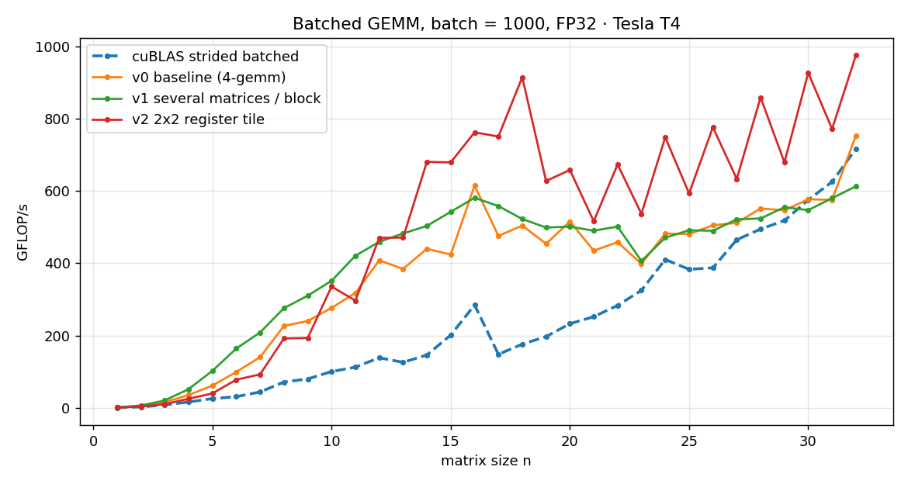
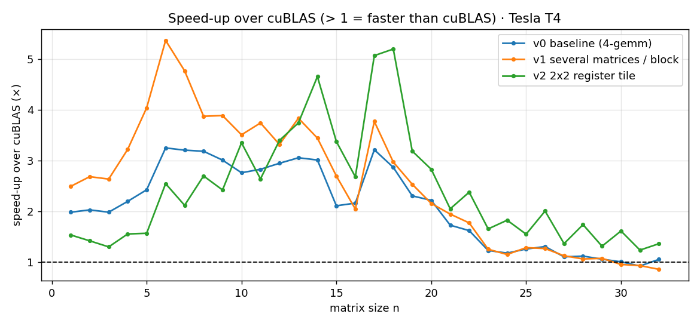
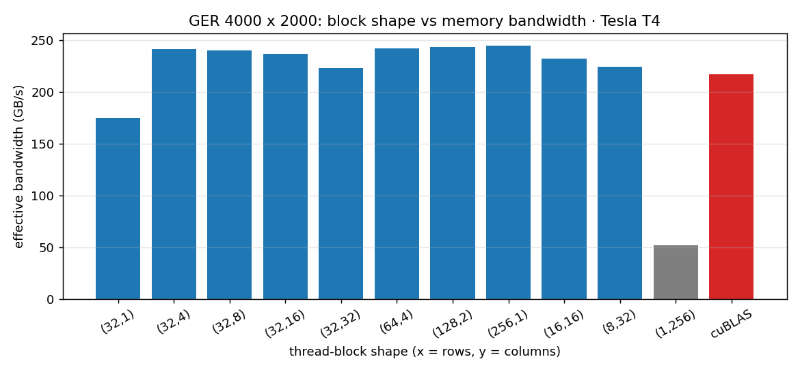

# AKT26 Hackathon · Homework 4: "CUDA: From Zero to Hero"
**Team 1036 · THE COUNCIL** (Al Akhawayn University in Ifrane, Morocco)

Fork of [abdelfattah83/akt26_gpu_dev](https://github.com/abdelfattah83/akt26_gpu_dev). The two graded assignments are in **`3-ger/`** and **`4-gemm/`** (directory names, `main` functions and makefiles unchanged). **`5-extras/`** holds optional performance studies that go beyond the assignment.

All results below were measured on a **Tesla T4 (Google Colab, CUDA 13.0, compute capability 7.5)**.

---

## How to build and run
```bash
cd 3-ger  && make && ./ger [M] [N] [repeats]      # default 4000 x 2000
cd 4-gemm && make && ./gemm [n <= 32] [batch]     # default 16 x 16, batch 1000
```
The makefiles target `sm=80` (Ampere). On another GPU, override the architecture without editing the makefile, e.g. `make sm=75` on a T4.

To reproduce everything (graded runs, `compute-sanitizer`, both studies and the plots):
```bash
bash 5-extras/run_all.sh 75        # writes 5-extras/results_<GPU>/
```

---

## Assignment 1 · `3-ger`: rank-1 update `A ← A + α·x·yᵀ` (column-major)
**Design.** One thread per matrix element on a 2D grid: `x` → row `i`, `y` → column `j`. The 32 threads of a warp take 32 consecutive **rows of the same column**, which are consecutive addresses in column-major storage, so every access is **coalesced**. Block = **32 × 8 = 256 threads**; grid = ⌈m/32⌉ × ⌈n/8⌉; a bounds check `if (i < m && j < n)` handles sizes that are not multiples of the block.

| m × n | Custom (µs) | Custom GFLOP/s | cuBLAS SGER (µs) | Speed-up vs cuBLAS | Error norm |
|---|---|---|---|---|---|
| 4000 × 2000 (default) | 267.8 | 59.7 | 299.3 | **1.12×** | 4.4e-08 |
| 1000 × 777 | 15.3 | 101.5 | 12.7 | 0.83× | 4.4e-08 |
| 4001 × 3 | 2.5 | 9.6 | 3.0 | 1.20× | 4.5e-08 |
| 33 × 65 | 2.5 | 1.7 | 3.4 | 1.32× | 4.4e-08 |
| 1 × 1 | 2.9 | — | 2.8 | 0.95× | 0 |

All runs print **TEST PASS** (tolerance 1e-6).

**Why it performs like this.** GER is **memory-bound**: each element of A is read and written once (8 bytes) for only 2 flops. At 4000 × 2000 our kernel moves ≈ 64 MB in 268 µs, i.e. **≈ 240 GB/s, about 75% of the T4's 320 GB/s peak**. That is the real ceiling, which is why we match or slightly beat cuBLAS.

## Assignment 2 · `4-gemm`: batched GEMM `C[b] = A[b]·B[b]`, n ≤ 32
**Design.** **One thread block per matrix, one thread per element of C** (block = n × n ≤ 1024 threads, grid = batch). Each block first copies A[b] and B[b] into **shared memory** (coalesced loads, `threadIdx.x` = row), then `__syncthreads()`, then each thread computes its dot product of length n from shared memory. The only early exit is uniform for a whole block, so no thread can skip the barrier. The host code handles allocation, transfers, CUDA-event timing (warm-up + 100 repeats), the comparison with `cublasSgemmStridedBatched` (C is cleared first so the check is independent), and cleanup.

| n × n, batch | Custom (µs) | Custom GFLOP/s | cuBLAS (µs) | cuBLAS GFLOP/s | Speed-up | Max fwd error |
|---|---|---|---|---|---|---|
| 16 × 16, 1000 (default) | 16.4 | 500.2 | 35.3 | 232.0 | **2.16×** | 2.4e-08 |
| 32 × 32, 1000 | 102.5 | 639.1 | 99.1 | 661.0 | 0.97× | 1.3e-08 |
| 7 × 7, 5000 | 21.0 | 163.2 | 88.3 | 38.8 | **4.20×** | 3.1e-08 |
| 31 × 31, 20000 | 2393.9 | 497.8 | 2235.7 | 533.0 | 0.93× | 3.8e-08 |
| 17 × 17, 1 | 2.5 | 3.9 | 7.3 | 1.3 | 2.88× | 3.2e-09 |
| 1 × 1, 1000 | 4.1 | 0.5 | 7.0 | 0.3 | 1.70× | 0 |

All runs print **TEST PASS**. Our kernel beats cuBLAS on small matrices, where cuBLAS's generic tiles are mostly empty, and ties with it around n = 32.

## Correctness tools · `compute-sanitizer`
| Check | Program | Result |
|---|---|---|
| memcheck + leak check | `ger 300 200 2` | **0 errors, 0 bytes leaked** |
| memcheck + leak check | `gemm 7 50` | **0 errors, 0 bytes leaked** |
| racecheck (shared memory) | `gemm 16 20` | **0 hazards** |
| synccheck (barriers) | `gemm 32 10` | **0 errors** |
| racecheck | `5-extras/gemm_opt` (all n = 1..32) | **0 hazards** |

Full logs: [`5-extras/results_Tesla_T4/sanitizer.txt`](5-extras/results_Tesla_T4/sanitizer.txt) and [`graded_runs.txt`](5-extras/results_Tesla_T4/graded_runs.txt).

---

## Extras · going further (`5-extras/`, not part of the graded code)

### A. Optimized batched GEMM: faster than cuBLAS for every n = 1..32
[`gemm_opt.cu`](5-extras/gemm_opt.cu) compares three kernels with cuBLAS for every n from 1 to 32 (batch 1000). Every kernel is validated against the CPU reference.
* **v0 baseline**: the `4-gemm` kernel.
* **v1 several matrices per block**: for small n a block of n² threads leaves warp lanes idle (n = 7 → 49 threads = 1.5 warps). We pack up to 256 / n² matrices per block (`blockDim.z`, capped at the CUDA limit of 64) so that warps are full.
* **v2 2 × 2 register tile**: each thread computes 4 elements of C, keeping 2 values of A and 2 of B in registers per step: **1 shared-memory load per FMA instead of 2**, the same idea as cuBLAS's register blocking.

| n range | Best kernel | Best GFLOP/s | cuBLAS GFLOP/s | Speed-up over cuBLAS |
|---|---|---|---|---|
| 1 – 11 | v1 several matrices / block | 0.8 → 421 | 0.3 → 112 | **2.5× – 5.4×** |
| 12 – 32 | v2 2 × 2 register tile | 470 → **976** | 138 → 717 | **1.2× – 5.2×** |
| n = 32 | v2 | **975.6** | 717.1 | **1.36×** |




### B. GER: thread-block shape vs memory bandwidth
[`ger_sweep.cu`](5-extras/ger_sweep.cu) runs our GER kernel with 11 block shapes on 4 matrix sizes.
* **Coalescing matters most.** With block (1, 256), consecutive threads walk *down a row* (addresses m·4 bytes apart): **≈ 57 GB/s, 4× slower** than any shape with `block.x ≥ 32` (≈ 240 GB/s).
* **Enough warps matter too.** (32, 1) blocks have a single warp each and reach only ≈ 180 GB/s; 4 or more warps per block (128–256 threads) hide memory latency.
* At 8192 × 8192 our best shape (256, 1) reaches **248 GB/s vs 231 GB/s for cuBLAS SGER**.



Raw data: [`gemm_sweep.csv`](5-extras/results_Tesla_T4/gemm_sweep.csv), [`ger_sweep.csv`](5-extras/results_Tesla_T4/ger_sweep.csv).
